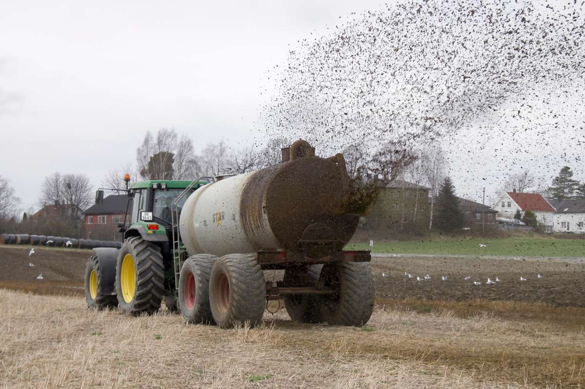
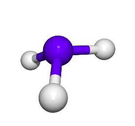
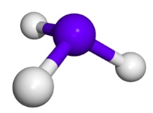

## 

Modèles d’apprentissage automatique pour prédire les émissions d’ammoniac issues de la fertilisation organique

<!--
::: {.center}
Quantitative synthesis of experimental data to predict ammonia volatilization under agricultural fertilization conditions
:::
-->

:::: {.columns}

::: {.column width="50%" .tiny-text}

Armand Favrot - MIA & EcoSys (INRAE)

David Makowski - MIA (INRAE)

Sophie Génermont - EcoSys (INRAE)

Céline Decuq - Ecosys (INRAE)

Vincent Guigue - MIA (INRAE)
:::

::: {.column width="50%" .tiny3-text}
:::

::::

::: {.center .small-text}
9 décembre 2026
:::

## 

Thank you for your attention !

## References

::: {#refs .references}
:::

